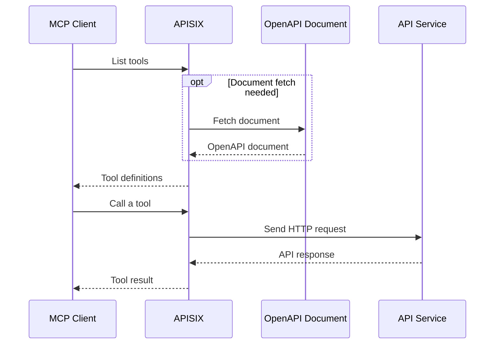

<!--
#
# Licensed to the Apache Software Foundation (ASF) under one or more
# contributor license agreements.  See the NOTICE file distributed with
# this work for additional information regarding copyright ownership.
# The ASF licenses this file to You under the Apache License, Version 2.0
# (the "License"); you may not use this file except in compliance with
# the License.  You may obtain a copy of the License at
#
#     http://www.apache.org/licenses/LICENSE-2.0
#
# Unless required by applicable law or agreed to in writing, software
# distributed under the License is distributed on an "AS IS" BASIS,
# WITHOUT WARRANTIES OR CONDITIONS OF ANY KIND, either express or implied.
# See the License for the specific language governing permissions and
# limitations under the License.
#
-->

<head>
  <link rel="canonical" href="https://docs.api7.ai/hub/openapi-to-mcp" />
</head>

import Tabs from '@theme/Tabs';
import TabItem from '@theme/TabItem';

## Description

The `openapi-to-mcp` Plugin exposes an existing HTTP API to [Model Context Protocol](https://modelcontextprotocol.io/) (MCP) clients, such as LLM agents, without changing the API. It fetches the API's OpenAPI document, generates one MCP tool per operation, and answers the MCP protocol itself. When a client calls a tool, the Plugin sends the corresponding HTTP request to the API and returns the response as the tool result.

The MCP server runs inside APISIX. No additional process or service is required.

The following sequence shows how APISIX discovers tools and invokes the described API:



The Plugin supports:

* The Streamable HTTP transport (stateless) and the HTTP+SSE transport.
* MCP protocol versions `2024-10-07`, `2024-11-05`, `2025-03-26`, `2025-06-18` and `2025-11-25`, negotiated during `initialize`.
* The `initialize`, `ping`, `tools/list` and `tools/call` methods.
* OpenAPI 3.x documents in JSON or YAML. Internal and `http(s)` `$ref` references are resolved. Swagger 2.0 documents are read on a best-effort basis: `in: body` and `in: formData` parameters are not turned into tool inputs.

## Attributes

| Name               | Type    | Required | Default | Valid values                | Description |
|--------------------|---------|----------|---------|-----------------------------|-------------|
| transport          | string  | False    | `sse`   | [`sse`, `streamable_http`]  | MCP transport served on the Route. |
| openapi_url        | string  | True     |         |                             | URL of the OpenAPI document. The document is fetched on the first request and the generated tools are cached for an hour. The response must be an OpenAPI or Swagger document with a `paths` object; anything else is reported as an error on every MCP request. |
| base_url           | string  | True     |         |                             | Base URL of the API the tools call. The path of each operation is appended to it. Supports [APISIX variables](../apisix-variable.md) and [NGINX variables](http://nginx.org/en/docs/varindex.html), for example `http://${http_x_backend}`. |
| headers            | object  | False    |         |                             | Headers added to every request sent to the API. Values support variables, for example `"Authorization": "Bearer ${http_x_api_token}"`. |
| flatten_parameters | boolean | False    | `false` |                             | When `false`, the tool input nests parameters under `pathParameters`, `queryParameters` and `headerParameters`. When `true`, they are placed directly in the input object. |
| allow_encoded_path_separators | boolean | False | `false` | | Whether path parameter values may contain `/` or `\`, which are percent-encoded before the upstream request. Enable this only when the upstream consistently treats encoded separators as data. Separator-delimited empty, `.`, and `..` components remain forbidden. |
| max_response_body_size | integer | False | `1048576` | >= 1024 | Maximum size, in bytes, of an upstream response read into a tool result. A larger response fails the call with `RESPONSE_TOO_LARGE` instead of being buffered. A tool result over 256 KiB is returned as compact JSON rather than indented. |
| max_document_size | integer | False | `4194304` | >= 1024 | Maximum size, in bytes, of the OpenAPI document, and of any document an `http(s)` `$ref` pulls in. A larger document fails the Route rather than being read into the worker. |
| max_expanded_nodes | integer | False | `50000` | >= 1000 | Maximum number of nodes one `$ref` expansion may produce in the tool input schemas. Past it, every `$ref` still being expanded and every one after it degrades to a generic object, which a very large document can reach legitimately. Only `paths` is expanded, so the document's other sections do not count towards it. |
| allowed_ref_hosts | array[string] | False | | | Hosts an `http(s)` `$ref` inside the document may point at, besides the origin `openapi_url` itself was fetched from. Each entry is a hostname or a `*.example.com` wildcard, optionally followed by `:port`; without a port it matches any port on that host. |
| allowed_origins | array[string] | False | | | `Origin` header values accepted on MCP requests, written as `scheme://host[:port]`. When set, the list governs on its own; `["*"]` accepts any origin. When unset, an `Origin` is accepted only if its host is a literal host the Route declares in `host`/`hosts` -- a `*.example.com` entry does not count -- or if both it and the request are on a loopback address. The default check also requires matching schemes and effective ports. A request with no `Origin` header is always accepted. |

Tool call arguments are validated against the generated input schema before the API is called, and then filtered to the parameters the operation declares: an argument the document does not mention is dropped rather than sent. A call to an unknown tool, or with invalid arguments, returns a result with `isError` set to `true`. Every `default` declared in the document is filled in before that validation, so a parameter or a body property that is `required` and has a `default` may be omitted by the client; an argument the client does send is never replaced by the default.

When a tool is called, the Plugin builds the request from the operation:

* Parameters declared on the Path Item apply to every operation under it; an operation parameter with the same name and location overrides them.
* Query parameters are serialized according to their `style` and `explode`, as defined by the [OpenAPI Parameter Object](https://spec.openapis.org/oas/v3.0.3#style-values). With the defaults (`form`, exploded), `tags: ["a", "b"]` is sent as `tags=a&tags=b` -- not as `tags[]=a&tags[]=b`, and an array parameter declared `explode: false` is sent as `tags=a,b`. `spaceDelimited`, `pipeDelimited` and `deepObject` are supported. An API that expects the bracket form has to be reached through a Plugin that rewrites the query string.
* A request body is sent with the media type the operation declares, unless `headers` sets `Content-Type`.
* Header parameters are applied before the Plugin's own `headers`, so a tool call cannot replace a credential the route adds, and a header whose value contains a newline is dropped.
* By default, a path parameter cannot contain `/` or `\`. Set `allow_encoded_path_separators` to `true` only for an upstream that consistently treats `%2F` and `%5C` as data; the Plugin then permits separators but still rejects a value with an empty, `.` or `..` separator-delimited component. Once every parameter is filled in, a segment an expression helped build also cannot be empty, `.` or `..`. What counts is the finished segment, so `/files/{name}.json` with `name` set to `..` is accepted and addresses `/files/...json`. These checks apply only to expressions in the URI path; an expression in a template's query suffix is encoded as query data, and a fragment suffix is removed because URI fragments are not sent in HTTP requests. A rejection fails the call with `isError` set.

## Security considerations

An OpenAPI-to-MCP Route turns an API description into tools and sends tool calls to the described API. This creates two trust boundaries: the document controls what the client sees, and tool arguments influence requests leaving APISIX.

### Trust the Document and API Destination

Load `openapi_url` from a source you control. Tool names, descriptions, input schemas, and operations come from the document, so a compromised document can influence the model using the Route.

By default, an external `http(s)` `$ref` must use the same scheme, host, and port as `openapi_url`. Add only required hosts to `allowed_ref_hosts`, and do not allow references to internal services or metadata endpoints unless the document requires them.

Keep `base_url` fixed or derive it from a gateway-controlled variable. A value such as `http://${http_x_backend}` lets the caller choose where tool calls are sent when the variable comes directly from a client header.

### Validate Browser Origins

Browser-based MCP clients send an `Origin` header. APISIX compares that origin with the Route and request to protect browser-accessible MCP Routes from DNS-rebinding attacks. This check is not authentication, and requests without an origin are accepted.

When `allowed_origins` is not configured and the Route declares literal hosts, APISIX accepts an origin only when all the following conditions are met:

* The origin host is a literal value in the Route's `host` or `hosts` field. A wildcard Route host does not establish trust.
* The origin and request use the same protocol.
* The origin and request use the same port. When the port is omitted, APISIX uses 80 for HTTP or 443 for HTTPS.

If the Route has no literal host, APISIX also accepts an origin and request that both use loopback hosts, with matching protocols and ports. Configure `allowed_origins` when trusted browser origins differ from the Route host, including deployments where TLS terminates before APISIX.

:::caution

List trusted origins explicitly. Allowing every origin removes the DNS-rebinding protection provided by this check.

:::

### Constrain Tool Calls

APISIX validates tool arguments against the generated input schema and applies declared defaults before validation. A call to an unknown tool or with invalid arguments returns a tool result with `isError: true` without calling the API.

APISIX forwards only the path, query, and header parameters declared by the matching OpenAPI operation. Undeclared arguments are discarded. Headers configured on the Route take precedence over headers supplied by a tool call, including names that differ only by letter case. From tool-call header parameters, APISIX discards the following:

* Headers that select the destination or define the request body: `Host`, `Content-Length`, and `Transfer-Encoding`.
* Headers that alter connection behavior: `Connection`, `Upgrade`, `Expect`, `Keep-Alive`, `TE`, and `Trailer`.
* Proxy authentication headers: `Proxy-Authenticate` and `Proxy-Authorization`.
* Invalid header names and values containing a newline.

Configured headers apply to every operation exposed by the document. Expose only operations that may share those credentials. The [`consumer-restriction`](consumer-restriction.md) Plugin can restrict access to the MCP Route, but it does not authorize individual tools.

### Limit Resource Use

Documents, expanded schemas, and tool responses can consume gateway memory. APISIX bounds each stage independently:

| Resource | Behavior at the limit |
| --- | --- |
| Main and referenced OpenAPI documents | APISIX rejects a document that exceeds `max_document_size` |
| Expanded operation definitions | Remaining references become generic object schemas when expansion reaches `max_expanded_nodes` |
| Tool response bodies | The tool call fails with `RESPONSE_TOO_LARGE` when the response exceeds `max_response_body_size` |

Set the limits for the largest trusted documents and API responses the Route needs.

### Isolate SSE Sessions

An SSE connection preserves state across multiple requests. APISIX resolves variables in `base_url` and `headers` when the stream opens and reuses the resolved values for the session, which can remain in memory for up to 30 minutes.

| Scope | Behavior |
| --- | --- |
| Session identity | A session belongs to the Route that opened it and to the authenticated Consumer, if present. Requests from another Route or Consumer are rejected |
| Gateway instance | Session state is shared by workers in one APISIX instance but not across instances. Configure session affinity so the stream and message requests reach the same instance |
| Connection capacity | Each stream holds a connection until it closes or reaches its lifetime limit. Apply [`limit-conn`](limit-conn.md) to Routes reachable by untrusted clients |

Streamable HTTP is stateless and does not require session affinity.

:::info

APISIX caches a failed tool-list build for five seconds in the worker that handled it. Requests reaching the same worker during that interval return the cached error without fetching the document or writing the same error log. After five seconds, the next request retries.

:::

## Examples

The following examples configure the `openapi-to-mcp` Plugin for common MCP workflows.

The Admin API commands use `${ADMIN_API_KEY}` for the [Admin API key](../admin-api.md).

### Start the Example Upstream

The examples use Petstore as the API. Petstore serves both the OpenAPI document and the operations exposed as MCP tools. Its container image is available for `linux/amd64`.

Set `GATEWAY_CONTAINER` to the running APISIX container. Create a network for the example and connect APISIX to it. Skip a command if the network or connection already exists.

```shell
export GATEWAY_CONTAINER=replace-with-apisix-container-name

docker network create gateway-petstore-net
docker network connect gateway-petstore-net "$GATEWAY_CONTAINER"
```

Create a Compose file for Petstore on the shared network:

```yaml title="docker-compose.petstore.yaml"
services:
  petstore:
    image: swaggerapi/petstore3:1.0.27
    platform: linux/amd64
    networks:
      - gateway-petstore-net
    ports:
      - "18080:8080"

networks:
  gateway-petstore-net:
    external: true
```

Start Petstore:

```shell
docker compose -f docker-compose.petstore.yaml up -d
```

Confirm that the OpenAPI document is available:

```shell
curl -fsS "http://127.0.0.1:18080/api/v3/openapi.json" > /dev/null
```

### Expose Petstore as MCP Tools

Create a Streamable HTTP Route with the `openapi-to-mcp` Plugin:

```shell
curl "http://127.0.0.1:9180/apisix/admin/routes" -X PUT \
  -H "X-API-KEY: ${ADMIN_API_KEY}" \
  -d '{
    "id": "openapi-to-mcp-route",
    "uri": "/mcp",
    "methods": ["POST"],
    "plugins": {
      "openapi-to-mcp": {
        "transport": "streamable_http",
        "base_url": "http://petstore:8080/api/v3",
        "openapi_url": "http://petstore:8080/api/v3/openapi.json"
      }
    }
  }'
```

List the generated tools. Streamable HTTP clients must accept both JSON and event-stream responses:

```shell
curl -N "http://127.0.0.1:9080/mcp" \
  -H "Content-Type: application/json" \
  -H "Accept: application/json, text/event-stream" \
  -d '{
    "jsonrpc": "2.0",
    "id": 1,
    "method": "tools/list"
  }'
```

The response should contain a tools list that includes `getPetById`:

```text
event: message
data: {"result":{"tools":[{"name":"getPetById", ...}]},"jsonrpc":"2.0","id":1}
```

Call that tool to confirm that APISIX can reach Petstore:

```shell
curl -N "http://127.0.0.1:9080/mcp" \
  -H "Content-Type: application/json" \
  -H "Accept: application/json, text/event-stream" \
  -d '{
    "jsonrpc": "2.0",
    "id": 2,
    "method": "tools/call",
    "params": {
      "name": "getPetById",
      "arguments": {
        "pathParameters": {
          "petId": 1
        }
      }
    }
  }'
```

The tool result contains the Petstore resource with ID `1`. It is returned as JSON text containing the API response status, status text, headers, and body.

```text
event: message
data: {"result":{"content":[{"type":"text","text":"{\n  \"status\": 200,\n  \"statusText\": \"OK\", ..."}]},"jsonrpc":"2.0","id":2}
```

Configure an MCP client to connect to the gateway address followed by `/mcp`:

```json title="mcp.json"
{
  "mcpServers": {
    "petstore-mcp": {
      "url": "http://127.0.0.1:9080/mcp"
    }
  }
}
```

After the client connects, confirm that it lists `getPetById`, then ask it to retrieve pet `1`.

#### Configure with Ingress Controller

Deploy Petstore in the namespace used by the Ingress Controller. The following example uses `aic`:

```yaml title="petstore.yaml"
apiVersion: apps/v1
kind: Deployment
metadata:
  namespace: aic
  name: petstore
spec:
  replicas: 1
  selector:
    matchLabels:
      app: petstore
  template:
    metadata:
      labels:
        app: petstore
    spec:
      nodeSelector:
        kubernetes.io/arch: amd64
      containers:
        - name: petstore
          image: swaggerapi/petstore3:1.0.27
          ports:
            - containerPort: 8080
---
apiVersion: v1
kind: Service
metadata:
  namespace: aic
  name: petstore
spec:
  selector:
    app: petstore
  ports:
    - port: 8080
      targetPort: 8080
```

Apply the manifest and wait for Petstore:

```shell
kubectl apply -f petstore.yaml
kubectl rollout status -n aic deployment/petstore
```

Create the MCP Route using Gateway API or the APISIX custom resource:

<Tabs
groupId="k8s-api"
defaultValue="gateway-api"
values={[
{label: 'Gateway API', value: 'gateway-api'},
{label: 'APISIX CRD', value: 'apisix-crd'}
]}>

<TabItem value="gateway-api">

```yaml title="openapi-to-mcp-ic.yaml"
apiVersion: apisix.apache.org/v1alpha1
kind: PluginConfig
metadata:
  namespace: aic
  name: openapi-to-mcp-plugin-config
spec:
  plugins:
    - name: openapi-to-mcp
      config:
        transport: streamable_http
        base_url: "http://petstore:8080/api/v3"
        openapi_url: "http://petstore:8080/api/v3/openapi.json"
---
apiVersion: gateway.networking.k8s.io/v1
kind: HTTPRoute
metadata:
  namespace: aic
  name: openapi-to-mcp-route
spec:
  parentRefs:
    - name: apisix
  rules:
    - matches:
        - path:
            type: Exact
            value: /mcp
          method: POST
      filters:
        - type: ExtensionRef
          extensionRef:
            group: apisix.apache.org
            kind: PluginConfig
            name: openapi-to-mcp-plugin-config
      backendRefs:
        - name: petstore-external-domain
          port: 8080
---
apiVersion: v1
kind: Service
metadata:
  namespace: aic
  name: petstore-external-domain
spec:
  type: ExternalName
  externalName: petstore.aic.svc.cluster.local
  ports:
    - port: 8080
---
apiVersion: apisix.apache.org/v1alpha1
kind: BackendTrafficPolicy
metadata:
  namespace: aic
  name: petstore-external-domain
spec:
  targetRefs:
    - group: ""
      kind: Service
      name: petstore-external-domain
  passHost: node
  scheme: http
```

</TabItem>

<TabItem value="apisix-crd">

```yaml title="openapi-to-mcp-ic.yaml"
apiVersion: apisix.apache.org/v2
kind: ApisixRoute
metadata:
  namespace: aic
  name: openapi-to-mcp-route
spec:
  ingressClassName: apisix
  http:
    - name: openapi-to-mcp-route
      match:
        paths:
          - /mcp
        methods:
          - POST
      plugins:
        - name: openapi-to-mcp
          enable: true
          config:
            transport: streamable_http
            base_url: "http://petstore:8080/api/v3"
            openapi_url: "http://petstore:8080/api/v3/openapi.json"
```

</TabItem>
</Tabs>

Apply the configuration:

```shell
kubectl apply -f openapi-to-mcp-ic.yaml
```

### Connect over SSE

Use SSE when the MCP client expects a long-lived event stream and a separate message endpoint. For multiple APISIX instances, configure session affinity so the stream and message requests reach the same instance.

Update the Petstore Route to accept both the SSE stream and message requests:

```shell
curl "http://127.0.0.1:9180/apisix/admin/routes/openapi-to-mcp-route" -X PATCH \
  -H "X-API-KEY: ${ADMIN_API_KEY}" \
  -d '{
    "methods": ["GET", "POST"],
    "plugins": {
      "openapi-to-mcp": {
        "transport": "sse"
      }
    }
  }'
```

Open the SSE stream. The first event contains the message endpoint for the session:

```shell
curl -N "http://127.0.0.1:9080/mcp"
```

```text
event: endpoint
data: /mcp?sessionId=4c9b0a4e-1bb0-4f4d-9b0b-2f3c3e0f7a51
```

Send a tool-list request to the endpoint returned by APISIX:

```shell
curl "http://127.0.0.1:9080/mcp?sessionId=<SESSION_ID>" \
  -H "Content-Type: application/json" \
  -d '{
    "jsonrpc": "2.0",
    "id": 1,
    "method": "tools/list"
  }'
```

The POST returns `202 Accepted`. Read the tool list in a `message` event on the original stream.

For the remaining examples, restore the Route to Streamable HTTP:

```shell
curl "http://127.0.0.1:9180/apisix/admin/routes/openapi-to-mcp-route" -X PATCH \
  -H "X-API-KEY: ${ADMIN_API_KEY}" \
  -d '{
    "methods": ["POST"],
    "plugins": {
      "openapi-to-mcp": {
        "transport": "streamable_http"
      }
    }
  }'
```

#### Configure SSE with Ingress Controller

Update the manifest from [Expose Petstore as MCP Tools](#expose-petstore-as-mcp-tools) and preserve its other resources:

<Tabs
groupId="k8s-api"
defaultValue="gateway-api"
values={[
{label: 'Gateway API', value: 'gateway-api'},
{label: 'APISIX CRD', value: 'apisix-crd'}
]}>

<TabItem value="gateway-api">

```yaml title="openapi-to-mcp-ic.yaml (updated resources)"
apiVersion: apisix.apache.org/v1alpha1
kind: PluginConfig
metadata:
  namespace: aic
  name: openapi-to-mcp-plugin-config
spec:
  plugins:
    - name: openapi-to-mcp
      config:
        transport: sse
        base_url: "http://petstore:8080/api/v3"
        openapi_url: "http://petstore:8080/api/v3/openapi.json"
---
apiVersion: gateway.networking.k8s.io/v1
kind: HTTPRoute
metadata:
  namespace: aic
  name: openapi-to-mcp-route
spec:
  parentRefs:
    - name: apisix
  rules:
    - matches:
        - path:
            type: Exact
            value: /mcp
          method: GET
        - path:
            type: Exact
            value: /mcp
          method: POST
      filters:
        - type: ExtensionRef
          extensionRef:
            group: apisix.apache.org
            kind: PluginConfig
            name: openapi-to-mcp-plugin-config
      backendRefs:
        - name: petstore-external-domain
          port: 8080
```

</TabItem>
<TabItem value="apisix-crd">

```yaml title="openapi-to-mcp-ic.yaml (updated ApisixRoute)"
apiVersion: apisix.apache.org/v2
kind: ApisixRoute
metadata:
  namespace: aic
  name: openapi-to-mcp-route
spec:
  ingressClassName: apisix
  http:
    - name: openapi-to-mcp-route
      match:
        paths:
          - /mcp
        methods:
          - GET
          - POST
      plugins:
        - name: openapi-to-mcp
          enable: true
          config:
            transport: sse
            base_url: "http://petstore:8080/api/v3"
            openapi_url: "http://petstore:8080/api/v3/openapi.json"
```

</TabItem>
</Tabs>

Reapply the manifest:

```shell
kubectl apply -f openapi-to-mcp-ic.yaml
```

Open the stream and leave it running, then use the returned endpoint from a second terminal as shown above. For the remaining examples, restore `transport: streamable_http` and the original Route methods.

### Configure Authentication for MCP Routes

Gateway authentication Plugins run before MCP requests are handled. The following example uses `key-auth` so that only a configured Consumer can list or call tools.

Create a Consumer and credential:

```shell
curl "http://127.0.0.1:9180/apisix/admin/consumers" -X PUT \
  -H "X-API-KEY: ${ADMIN_API_KEY}" \
  -d '{
    "username": "johndoe"
  }'

curl "http://127.0.0.1:9180/apisix/admin/consumers/johndoe/credentials" -X PUT \
  -H "X-API-KEY: ${ADMIN_API_KEY}" \
  -d '{
    "id": "johndoe-key-auth",
    "plugins": {
      "key-auth": {
        "key": "john-key"
      }
    }
  }'
```

Add `key-auth` to the existing MCP Route:

```shell
curl "http://127.0.0.1:9180/apisix/admin/routes/openapi-to-mcp-route" -X PATCH \
  -H "X-API-KEY: ${ADMIN_API_KEY}" \
  -d '{
    "plugins": {
      "key-auth": {
        "header": "apikey"
      }
    }
  }'
```

A request without the credential now returns `401`. Configure the MCP client to send the credential with every request:

```json title="mcp.json"
{
  "mcpServers": {
    "petstore-mcp": {
      "url": "http://127.0.0.1:9080/mcp",
      "headers": {
        "apikey": "john-key"
      }
    }
  }
}
```

If a client cannot send headers, `key-auth` reads the `apikey` query parameter by default when the header is absent. Use this option only where URLs containing credentials are protected from logs and other records.

#### Configure Authentication with Ingress Controller

Apply the complete example for the Kubernetes API used by the Ingress Controller:

<Tabs
groupId="k8s-api"
defaultValue="gateway-api"
values={[
{label: 'Gateway API', value: 'gateway-api'},
{label: 'APISIX CRD', value: 'apisix-crd'}
]}>

<TabItem value="gateway-api">

```yaml title="openapi-to-mcp-ic.yaml"
apiVersion: apisix.apache.org/v1alpha1
kind: Consumer
metadata:
  namespace: aic
  name: johndoe
spec:
  gatewayRef:
    name: apisix
  credentials:
    - type: key-auth
      name: primary-key
      config:
        key: john-key
---
apiVersion: apisix.apache.org/v1alpha1
kind: PluginConfig
metadata:
  namespace: aic
  name: openapi-to-mcp-plugin-config
spec:
  plugins:
    - name: key-auth
      config:
        header: apikey
    - name: openapi-to-mcp
      config:
        transport: streamable_http
        base_url: "http://petstore:8080/api/v3"
        openapi_url: "http://petstore:8080/api/v3/openapi.json"
---
apiVersion: gateway.networking.k8s.io/v1
kind: HTTPRoute
metadata:
  namespace: aic
  name: openapi-to-mcp-route
spec:
  parentRefs:
    - name: apisix
  rules:
    - matches:
        - path:
            type: Exact
            value: /mcp
          method: POST
      filters:
        - type: ExtensionRef
          extensionRef:
            group: apisix.apache.org
            kind: PluginConfig
            name: openapi-to-mcp-plugin-config
      backendRefs:
        - name: petstore-external-domain
          port: 8080
---
apiVersion: v1
kind: Service
metadata:
  namespace: aic
  name: petstore-external-domain
spec:
  type: ExternalName
  externalName: petstore.aic.svc.cluster.local
  ports:
    - port: 8080
---
apiVersion: apisix.apache.org/v1alpha1
kind: BackendTrafficPolicy
metadata:
  namespace: aic
  name: petstore-external-domain
spec:
  targetRefs:
    - group: ""
      kind: Service
      name: petstore-external-domain
  passHost: node
  scheme: http
```

</TabItem>
<TabItem value="apisix-crd">

```yaml title="openapi-to-mcp-ic.yaml"
apiVersion: apisix.apache.org/v2
kind: ApisixConsumer
metadata:
  namespace: aic
  name: johndoe
spec:
  ingressClassName: apisix
  authParameter:
    keyAuth:
      value:
        key: john-key
---
apiVersion: apisix.apache.org/v2
kind: ApisixRoute
metadata:
  namespace: aic
  name: openapi-to-mcp-route
spec:
  ingressClassName: apisix
  http:
    - name: openapi-to-mcp-route
      match:
        paths:
          - /mcp
        methods:
          - POST
      plugins:
        - name: key-auth
          enable: true
          config:
            header: apikey
        - name: openapi-to-mcp
          enable: true
          config:
            transport: streamable_http
            base_url: "http://petstore:8080/api/v3"
            openapi_url: "http://petstore:8080/api/v3/openapi.json"
```

</TabItem>
</Tabs>

Apply the updated manifest:

```shell
kubectl apply -f openapi-to-mcp-ic.yaml
```

### Flatten Tool Schema Parameters

By default, tool arguments are grouped by where the API expects them. The Petstore example sends `petId` inside `pathParameters`. Set `flatten_parameters` to `true` to place these arguments directly in the tool input. Keep the default when parameters in different locations share a name.

```shell
curl "http://127.0.0.1:9180/apisix/admin/routes/openapi-to-mcp-route" -X PATCH \
  -H "X-API-KEY: ${ADMIN_API_KEY}" \
  -d '{
    "plugins": {
      "openapi-to-mcp": {
        "flatten_parameters": true
      }
    }
  }'
```

List the tools again and inspect the `getPetById` input schema. Its `properties` should contain `petId` directly. Call it with `"arguments": {"petId": 1}`.

#### Flatten Parameters with Ingress Controller

Update the Plugin configuration and preserve the other resources:

<Tabs
groupId="k8s-api"
defaultValue="gateway-api"
values={[
{label: 'Gateway API', value: 'gateway-api'},
{label: 'APISIX CRD', value: 'apisix-crd'}
]}>

<TabItem value="gateway-api">

```yaml title="openapi-to-mcp-ic.yaml (updated PluginConfig)"
apiVersion: apisix.apache.org/v1alpha1
kind: PluginConfig
metadata:
  namespace: aic
  name: openapi-to-mcp-plugin-config
spec:
  plugins:
    - name: key-auth
      config:
        header: apikey
    - name: openapi-to-mcp
      config:
        transport: streamable_http
        base_url: "http://petstore:8080/api/v3"
        openapi_url: "http://petstore:8080/api/v3/openapi.json"
        flatten_parameters: true
```

</TabItem>
<TabItem value="apisix-crd">

```yaml title="openapi-to-mcp-ic.yaml (updated ApisixRoute)"
apiVersion: apisix.apache.org/v2
kind: ApisixRoute
metadata:
  namespace: aic
  name: openapi-to-mcp-route
spec:
  ingressClassName: apisix
  http:
    - name: openapi-to-mcp-route
      match:
        paths:
          - /mcp
        methods:
          - POST
      plugins:
        - name: key-auth
          enable: true
          config:
            header: apikey
        - name: openapi-to-mcp
          enable: true
          config:
            transport: streamable_http
            base_url: "http://petstore:8080/api/v3"
            openapi_url: "http://petstore:8080/api/v3/openapi.json"
            flatten_parameters: true
```

</TabItem>
</Tabs>

Reapply the manifest:

```shell
kubectl apply -f openapi-to-mcp-ic.yaml
```

### Customize MCP Tool Annotations

APISIX infers common MCP annotations from the HTTP method. Add the operation-level `x-mcp-annotations` extension to override those defaults or provide additional hints:

```yaml title="openapi.yaml"
paths:
  /pet/{petId}:
    get:
      operationId: getPetById
      summary: Find pet by ID.
      x-mcp-annotations:
        title: Get Pet by ID
        readOnlyHint: true
        openWorldHint: false
    delete:
      operationId: deletePet
      summary: Deletes a pet.
      x-mcp-annotations:
        title: Delete Pet
        destructiveHint: true
```

Host the modified document and update `openapi_url` on the Route:

```shell
curl "http://127.0.0.1:9180/apisix/admin/routes/openapi-to-mcp-route" -X PATCH \
  -H "X-API-KEY: ${ADMIN_API_KEY}" \
  -d '{
    "plugins": {
      "openapi-to-mcp": {
        "openapi_url": "<ANNOTATED_OPENAPI_URL>"
      }
    }
  }'
```

#### Update Annotations with Ingress Controller

Replace `<ANNOTATED_OPENAPI_URL>` in the resource used by the Ingress Controller and preserve the other resources:

<Tabs
groupId="k8s-api"
defaultValue="gateway-api"
values={[
{label: 'Gateway API', value: 'gateway-api'},
{label: 'APISIX CRD', value: 'apisix-crd'}
]}>

<TabItem value="gateway-api">

```yaml title="openapi-to-mcp-ic.yaml (updated PluginConfig)"
apiVersion: apisix.apache.org/v1alpha1
kind: PluginConfig
metadata:
  namespace: aic
  name: openapi-to-mcp-plugin-config
spec:
  plugins:
    - name: key-auth
      config:
        header: apikey
    - name: openapi-to-mcp
      config:
        transport: streamable_http
        base_url: "http://petstore:8080/api/v3"
        openapi_url: "<ANNOTATED_OPENAPI_URL>"
        flatten_parameters: true
```

</TabItem>
<TabItem value="apisix-crd">

```yaml title="openapi-to-mcp-ic.yaml (updated ApisixRoute)"
apiVersion: apisix.apache.org/v2
kind: ApisixRoute
metadata:
  namespace: aic
  name: openapi-to-mcp-route
spec:
  ingressClassName: apisix
  http:
    - name: openapi-to-mcp-route
      match:
        paths:
          - /mcp
        methods:
          - POST
      plugins:
        - name: key-auth
          enable: true
          config:
            header: apikey
        - name: openapi-to-mcp
          enable: true
          config:
            transport: streamable_http
            base_url: "http://petstore:8080/api/v3"
            openapi_url: "<ANNOTATED_OPENAPI_URL>"
            flatten_parameters: true
```

</TabItem>
</Tabs>

Reapply the manifest:

```shell
kubectl apply -f openapi-to-mcp-ic.yaml
```

The extension accepts the following fields:

```yaml
x-mcp-annotations:
  title: Tool title
  readOnlyHint: true
  destructiveHint: false
  idempotentHint: true
  openWorldHint: false
```

If the extension is absent, APISIX infers these defaults:

| HTTP method | Inferred annotations |
| --- | --- |
| `GET`, `HEAD`, `OPTIONS` | `readOnlyHint: true` |
| `DELETE` | `destructiveHint: true`, `idempotentHint: true` |
| `PUT` | `idempotentHint: true` |

Unsupported fields and invalid values are ignored. The operation's `summary` and `description` control the generated tool description; the tool title comes only from `x-mcp-annotations.title`.

Ask the MCP client to list tools again. The `result.tools` response should include the configured annotations:

```json
{
  "tools": [
    {
      "name": "getPetById",
      "annotations": {
        "title": "Get Pet by ID",
        "readOnlyHint": true,
        "openWorldHint": false
      }
    },
    {
      "name": "deletePet",
      "annotations": {
        "title": "Delete Pet",
        "destructiveHint": true,
        "idempotentHint": true
      }
    }
  ]
}
```

### Forward Client Headers to an API

Map selected client headers through APISIX variables when the described API needs per-client context. The following example protects an MCP Route with `key-auth` and forwards `X-Tenant-Id` to an HTTPBin operation:

Complete [Configure Authentication for MCP Routes](#configure-authentication-for-mcp-routes) first. The example reuses the `johndoe` Consumer and `john-key` credential.

```shell
curl "http://127.0.0.1:9180/apisix/admin/routes/openapi-to-mcp-client-headers" -X PUT \
  -H "X-API-KEY: ${ADMIN_API_KEY}" \
  -d '{
    "uri": "/mcp/headers",
    "methods": ["POST"],
    "plugins": {
      "key-auth": {
        "header": "apikey"
      },
      "openapi-to-mcp": {
        "transport": "streamable_http",
        "base_url": "https://httpbin.org",
        "headers": {
          "X-Tenant-Id": "${http_x_tenant_id}"
        },
        "openapi_url": "https://docs.api7.ai/openapi-to-mcp/httpbin-headers.yaml"
      }
    }
  }'
```

Configure the MCP client with the gateway credential and tenant header:

```json title="mcp.json"
{
  "mcpServers": {
    "httpbin-headers": {
      "url": "http://127.0.0.1:9080/mcp/headers",
      "headers": {
        "apikey": "john-key",
        "X-Tenant-Id": "tenant-42"
      }
    }
  }
}
```

APISIX forwards client-provided values only for headers explicitly mapped in the Plugin configuration. Ask the client to call the `getHeaders` tool. The result should include:

```json
{
  "headers": {
    "X-Tenant-Id": "tenant-42"
  }
}
```

Other Plugins on the Route continue to run. For example, `key-auth` or `limit-count` can reject an MCP request before it reaches the tools.

## Troubleshooting

Inspect the APISIX error log first. If a client cannot list tools, request `openapi_url` from the gateway's network environment and confirm that it returns HTTP `200` with an OpenAPI document containing API paths. An HTML login page, redirect, authentication error, or document containing only components cannot produce tools.

APISIX fetches `openapi_url` separately from API operation calls, so the Plugin's `headers` field does not authenticate the document request. If the document requires authentication, publish a reviewed copy at a location accessible to APISIX within a restricted network. Keep credentials out of the document URL.

If the document uses a private CA, add that CA to the gateway runtime trust store.

| Symptom | Likely cause | Action |
| --- | --- | --- |
| Browser request returns `403` with an origin error | The origin is not allowed, the Route has no matching literal host, or the protocol or port differs | Add the trusted origin to `allowed_origins`, accounting for TLS termination and external ports |
| An external reference becomes a generic object | Its target is neither same-origin nor allowed, or it cannot be fetched or parsed | Add only the required host to `allowed_ref_hosts`, then check APISIX warning logs and connectivity |
| A tool argument or header is not forwarded | The operation does not declare it, the header is protected, or its name or value is invalid | Correct the OpenAPI operation or configure the header on the Route |
| A tool call reports an invalid path parameter | The value contains a disallowed separator or creates an empty or dot segment | Keep the value within one path segment, or enable encoded separators only for a compatible API |
| Tool discovery returns an error | The document is unreachable, too large, invalid, or has no usable `paths` object | Check the document URL, response status, format, size, and APISIX error logs |
| A tool response reports `RESPONSE_TOO_LARGE` | The API response exceeds the configured response-body limit | Reduce the response or raise the limit after evaluating gateway memory use |
| An SSE message reports that the session was not found | The request reached another instance, Route, or Consumer, or the session expired | Check session affinity, Route selection, authentication, and session lifetime |

## Delete Plugin

To remove the `openapi-to-mcp` Plugin, delete it from the Route configuration. APISIX reloads the configuration automatically:

```shell
curl "http://127.0.0.1:9180/apisix/admin/routes" -X PUT \
  -H "X-API-KEY: ${ADMIN_API_KEY}" \
  -d '{
    "id": "openapi-to-mcp-route",
    "uri": "/mcp",
    "plugins": {},
    "upstream": {
      "type": "roundrobin",
      "nodes": {
        "127.0.0.1:1980": 1
      }
    }
  }'
```
