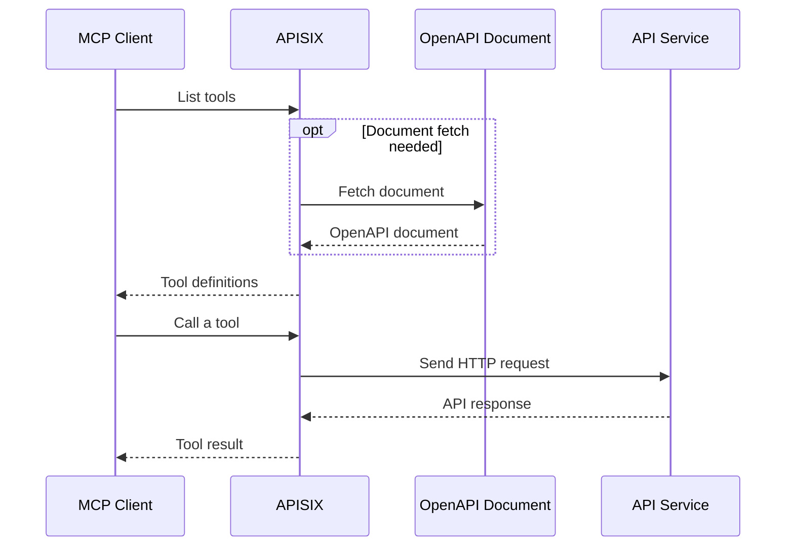

<!--
#
# Licensed to the Apache Software Foundation (ASF) under one or more
# contributor license agreements.  See the NOTICE file distributed with
# this work for additional information regarding copyright ownership.
# The ASF licenses this file to You under the Apache License, Version 2.0
# (the "License"); you may not use this file except in compliance with
# the License.  You may obtain a copy of the License at
#
#     http://www.apache.org/licenses/LICENSE-2.0
#
# Unless required by applicable law or agreed to in writing, software
# distributed under the License is distributed on an "AS IS" BASIS,
# WITHOUT WARRANTIES OR CONDITIONS OF ANY KIND, either express or implied.
# See the License for the specific language governing permissions and
# limitations under the License.
#
-->

<head>
  <link rel="canonical" href="https://docs.api7.ai/hub/openapi-to-mcp" />
</head>

import Tabs from '@theme/Tabs';
import TabItem from '@theme/TabItem';

## 描述

`openapi-to-mcp` 插件无需修改已有的 HTTP API，即可将其提供给 [Model Context Protocol](https://modelcontextprotocol.io/)（MCP）客户端（例如 LLM Agent）使用。插件会获取 API 的 OpenAPI 文档，为每个操作生成一个 MCP 工具，并由插件自身应答 MCP 协议。客户端调用工具时，插件向 API 发送对应的 HTTP 请求，并将响应作为工具结果返回。

MCP 服务运行在 APISIX 内部，不需要额外的进程或服务。

以下时序图展示了 APISIX 如何发现工具并调用 OpenAPI 文档描述的 API：



插件支持：

* Streamable HTTP 传输（无状态）和 HTTP+SSE 传输。
* MCP 协议版本 `2024-10-07`、`2024-11-05`、`2025-03-26`、`2025-06-18` 和 `2025-11-25`，在 `initialize` 时协商。
* `initialize`、`ping`、`tools/list` 和 `tools/call` 方法。
* JSON 或 YAML 格式的 OpenAPI 3.x 文档，支持解析内部引用和 `http(s)` 形式的 `$ref`。Swagger 2.0 文档尽力兼容：`in: body` 和 `in: formData` 参数不会转换为工具输入。

## 属性

| 名称 | 类型 | 必选项 | 默认值 | 有效值 | 描述 |
|------|------|--------|--------|--------|------|
| transport | string | 否 | `sse` | [`sse`, `streamable_http`] | 路由上提供的 MCP 传输方式。 |
| openapi_url | string | 是 | | | OpenAPI 文档的 URL。文档在首次请求时获取，生成的工具缓存一小时。返回内容必须是带 `paths` 对象的 OpenAPI 或 Swagger 文档，否则每次 MCP 请求都会返回错误。 |
| base_url | string | 是 | | | 工具调用的 API 基础地址，每个操作的路径拼接在其后。支持 [APISIX 变量](../apisix-variable.md) 和 [NGINX 变量](http://nginx.org/en/docs/varindex.html)，例如 `http://${http_x_backend}`。 |
| headers | object | 否 | | | 发往 API 的每个请求都会携带的请求头。值支持变量，例如 `"Authorization": "Bearer ${http_x_api_token}"`。 |
| flatten_parameters | boolean | 否 | `false` | | 为 `false` 时，工具输入中的参数分别嵌套在 `pathParameters`、`queryParameters` 和 `headerParameters` 下；为 `true` 时，参数直接放在输入对象的顶层。 |
| allow_encoded_path_separators | boolean | 否 | `false` | | 是否允许路径参数值包含 `/` 或 `\`；向上游发送请求前会对它们进行百分号编码。仅当上游始终将编码后的分隔符视为数据时才启用。由分隔符划分的空片段、`.` 片段和 `..` 片段仍不允许。 |
| max_response_body_size | integer | 否 | `1048576` | >= 1024 | 读取到工具结果中的上游响应体大小上限（字节）。超出时调用失败并返回 `RESPONSE_TOO_LARGE`，不会把响应缓冲下来。超过 256 KiB 的工具结果以紧凑 JSON 返回，不再缩进。 |
| max_document_size | integer | 否 | `4194304` | >= 1024 | OpenAPI 文档，以及文档内 `http(s)` 形式 `$ref` 拉取的文档的大小上限（字节）。超出上限的文档不会读入 worker，该路由直接报错。 |
| max_expanded_nodes | integer | 否 | `50000` | >= 1000 | 单次 `$ref` 展开在工具输入 Schema 中最多产生的节点数。超出后，仍在展开中的 `$ref` 及其后的所有 `$ref` 都降级为通用对象；足够大的正常文档也可能触及此上限。只有 `paths` 会被展开，文档其他部分不计入。 |
| allowed_ref_hosts | array[string] | 否 | | | 文档内 `http(s)` 形式的 `$ref` 除 `openapi_url` 自身所在来源（scheme、主机与端口）外还可以指向的主机。每项为主机名或 `*.example.com` 形式的通配符，可加 `:port`；不带端口时匹配该主机的任意端口。 |
| allowed_origins | array[string] | 否 | | | MCP 请求中允许的 `Origin` 头取值，写成 `scheme://host[:port]`。配置后完全以列表为准；`["*"]` 表示接受任意 origin。不配置时，`Origin` 只有在其主机是路由 `host`/`hosts` 声明的字面量主机（`*.example.com` 这类通配项不算），或它与请求两端都是回环地址时才被接受。默认检查还要求协议及有效端口一致。不带 `Origin` 头的请求始终放行。 |

调用 API 之前，插件会按生成的输入 Schema 校验工具参数，并按操作声明的参数过滤：文档中未声明的参数会被丢弃，不会发往 API。调用不存在的工具或参数不合法时，返回 `isError` 为 `true` 的结果。校验之前会先填入文档中声明的 `default`，因此同时带有 `required` 和 `default` 的参数或请求体属性可以由客户端省略；客户端显式传入的参数不会被默认值覆盖。

调用工具时，插件根据操作定义构造请求：

* 声明在 Path Item 上的参数适用于该路径下的所有操作；操作中同名且位置相同的参数会覆盖它。
* 查询参数按其 `style` 和 `explode` 序列化，规则见 [OpenAPI Parameter Object](https://spec.openapis.org/oas/v3.0.3#style-values)。使用默认值（`form`，展开）时，`tags: ["a", "b"]` 发送为 `tags=a&tags=b`，而不是 `tags[]=a&tags[]=b`；声明为 `explode: false` 的数组参数发送为 `tags=a,b`。同时支持 `spaceDelimited`、`pipeDelimited` 和 `deepObject`。如果 API 要求方括号形式，需要另外通过改写查询字符串的插件处理。
* 请求体使用操作中声明的媒体类型发送，除非 `headers` 中已设置 `Content-Type`。
* header 参数在插件自身的 `headers` 之前写入，因此工具调用无法覆盖路由添加的凭据；取值中含换行符的 header 会被丢弃。
* 默认情况下，路径参数不能包含 `/` 或 `\`。仅当上游始终将 `%2F` 和 `%5C` 视为数据时，才应将 `allow_encoded_path_separators` 设为 `true`；此时插件允许分隔符，但仍拒绝含有空、`.` 或 `..` 分隔片段的值。所有参数填充完成后，由模板表达式参与构成的片段也不能为空、为 `.` 或 `..`。判断以最终片段为准，因此 `/files/{name}.json` 的 `name` 取 `..` 时会被接受，访问 `/files/...json`。这些检查仅适用于 URI 路径中的表达式；模板查询后缀中的表达式会编码为查询数据，片段后缀则会被移除，因为 HTTP 请求不会发送 URI 片段。拒绝时调用失败并返回 `isError`。

## 安全注意事项

OpenAPI-to-MCP 路由会将 API 描述转换为工具，并将工具调用发送给文档描述的 API。这形成了两处信任边界：文档决定客户端看到的内容，工具参数则会影响离开 APISIX 的请求。

### 信任文档和 API 目标地址

请从自己可控的来源加载 `openapi_url`。工具名称、描述、输入 Schema 和操作均来自文档，因此被攻陷的文档可能影响使用该路由的模型。

默认情况下，外部 `http(s)` `$ref` 必须与 `openapi_url` 使用相同的协议、主机和端口。只将确实需要的主机加入 `allowed_ref_hosts`；除非文档确有需要，否则不要允许引用内部服务或元数据端点。

请固定 `base_url`，或使用网关控制的变量生成它。如果变量直接来自客户端请求头，`http://${http_x_backend}` 这样的值会让调用方决定工具调用的目标地址。

### 校验浏览器 Origin

基于浏览器的 MCP 客户端会发送 `Origin` 请求头。APISIX 会比较 Origin、路由和请求，以保护可由浏览器访问的 MCP 路由免受 DNS 重绑定攻击。此检查不能替代身份认证；不带 Origin 的请求会被接受。

未配置 `allowed_origins` 且路由声明了字面量主机时，只有同时满足以下条件的 Origin 才会被接受：

* Origin 主机是路由 `host` 或 `hosts` 字段中的字面量值，通配主机不能建立信任。
* Origin 与请求使用相同协议。
* Origin 与请求使用相同端口。省略端口时，HTTP 使用 80，HTTPS 使用 443。

如果路由没有字面量主机，APISIX 还会接受同时使用回环主机且协议和端口一致的 Origin 与请求。可信浏览器 Origin 与路由主机不同时，应配置 `allowed_origins`，包括 TLS 在 APISIX 之前终止的部署。

:::caution

请显式列出可信 Origin。允许所有 Origin 会移除此检查提供的 DNS 重绑定防护。

:::

### 约束工具调用

APISIX 会按生成的输入 Schema 校验工具参数，并在校验前应用文档声明的默认值。调用不存在的工具或传入无效参数时，APISIX 不会调用 API，而是返回 `isError: true` 的工具结果。

APISIX 只转发匹配 OpenAPI 操作所声明的路径、查询和请求头参数，未声明的参数会被丢弃。路由配置的请求头优先于工具调用提供的同名请求头，即使两者大小写不同也一样。对于工具调用传入的请求头参数，APISIX 会丢弃以下内容：

* 选择目标地址或定义请求体的请求头：`Host`、`Content-Length` 和 `Transfer-Encoding`。
* 改变连接行为的请求头：`Connection`、`Upgrade`、`Expect`、`Keep-Alive`、`TE` 和 `Trailer`。
* 代理认证请求头：`Proxy-Authenticate` 和 `Proxy-Authorization`。
* 名称无效或值中包含换行符的请求头。

配置的请求头会应用到文档暴露的每个操作。请只暴露可以共享这些凭据的操作。[`consumer-restriction`](consumer-restriction.md) 插件可以限制消费者对 MCP 路由的访问，但不能按工具授权。

### 限制资源使用

文档、展开后的 Schema 和工具响应都会占用网关内存。APISIX 会分别限制各阶段：

| 资源 | 达到限制时的行为 |
| --- | --- |
| 主 OpenAPI 文档和被引用的文档 | 文档超过 `max_document_size` 时，APISIX 拒绝该文档 |
| 展开后的操作定义 | 展开达到 `max_expanded_nodes` 时，其余引用会转换为通用对象 Schema |
| 工具响应体 | 响应超过 `max_response_body_size` 时，工具调用失败并返回 `RESPONSE_TOO_LARGE` |

请根据路由需要处理的最大可信文档和 API 响应设置这些限制。

### 隔离 SSE 会话

SSE 连接会跨多个请求保留状态。APISIX 在事件流建立时解析 `base_url` 和 `headers` 中的变量，并在整个会话中复用解析结果；这些值最长可在内存中保留 30 分钟。

| 范围 | 行为 |
| --- | --- |
| 会话身份 | 会话属于建立它的路由和已认证的消费者（如果存在）；来自其他路由或消费者的请求会被拒绝 |
| 网关实例 | 会话状态可由同一 APISIX 实例中的 worker 共享，但不会跨实例共享；请配置会话亲和性，使事件流和消息请求到达同一实例 |
| 连接容量 | 每条事件流会占用一个连接，直至关闭或达到生命周期上限；对不可信客户端可访问的路由应用 [`limit-conn`](limit-conn.md) |

Streamable HTTP 是无状态的，不需要会话亲和性。

:::info

APISIX 会在处理失败的 worker 中缓存工具列表构建错误五秒。在此期间到达同一 worker 的请求会返回缓存错误，不会重新获取文档或重复记录错误日志。五秒后，下一个请求会重试。

:::

## 使用示例

以下示例展示如何为常见 MCP 工作流配置 `openapi-to-mcp` 插件。

Admin API 命令使用 `${ADMIN_API_KEY}` 表示 [Admin API key](../admin-api.md)。

### 启动示例上游

示例使用 Petstore 作为 API。Petstore 同时提供 OpenAPI 文档和要暴露为 MCP 工具的 API 操作。其容器镜像支持 `linux/amd64`。

将 `GATEWAY_CONTAINER` 设为正在运行的 APISIX 容器。为示例创建网络并将 APISIX 接入该网络。如果网络或连接已经存在，请跳过相应命令。

```shell
export GATEWAY_CONTAINER=replace-with-apisix-container-name

docker network create gateway-petstore-net
docker network connect gateway-petstore-net "$GATEWAY_CONTAINER"
```

创建 Compose 文件，将 Petstore 接入同一网络：

```yaml title="docker-compose.petstore.yaml"
services:
  petstore:
    image: swaggerapi/petstore3:1.0.27
    platform: linux/amd64
    networks:
      - gateway-petstore-net
    ports:
      - "18080:8080"

networks:
  gateway-petstore-net:
    external: true
```

启动 Petstore：

```shell
docker compose -f docker-compose.petstore.yaml up -d
```

确认 OpenAPI 文档可以访问：

```shell
curl -fsS "http://127.0.0.1:18080/api/v3/openapi.json" > /dev/null
```

### 将 Petstore 暴露为 MCP 工具

创建启用 `openapi-to-mcp` 插件的 Streamable HTTP 路由：

```shell
curl "http://127.0.0.1:9180/apisix/admin/routes" -X PUT \
  -H "X-API-KEY: ${ADMIN_API_KEY}" \
  -d '{
    "id": "openapi-to-mcp-route",
    "uri": "/mcp",
    "methods": ["POST"],
    "plugins": {
      "openapi-to-mcp": {
        "transport": "streamable_http",
        "base_url": "http://petstore:8080/api/v3",
        "openapi_url": "http://petstore:8080/api/v3/openapi.json"
      }
    }
  }'
```

列出生成的工具。Streamable HTTP 客户端必须同时接受 JSON 和事件流响应：

```shell
curl -N "http://127.0.0.1:9080/mcp" \
  -H "Content-Type: application/json" \
  -H "Accept: application/json, text/event-stream" \
  -d '{
    "jsonrpc": "2.0",
    "id": 1,
    "method": "tools/list"
  }'
```

响应中的工具列表应包含 `getPetById`：

```text
event: message
data: {"result":{"tools":[{"name":"getPetById", ...}]},"jsonrpc":"2.0","id":1}
```

调用该工具，确认 APISIX 可以访问 Petstore：

```shell
curl -N "http://127.0.0.1:9080/mcp" \
  -H "Content-Type: application/json" \
  -H "Accept: application/json, text/event-stream" \
  -d '{
    "jsonrpc": "2.0",
    "id": 2,
    "method": "tools/call",
    "params": {
      "name": "getPetById",
      "arguments": {
        "pathParameters": {
          "petId": 1
        }
      }
    }
  }'
```

工具结果应包含 ID 为 `1` 的 Petstore 资源。结果以 JSON 文本返回，其中包含 API 响应状态码、状态文本、响应头和响应体。

```text
event: message
data: {"result":{"content":[{"type":"text","text":"{\n  \"status\": 200,\n  \"statusText\": \"OK\", ..."}]},"jsonrpc":"2.0","id":2}
```

将 MCP 客户端配置为连接网关地址后的 `/mcp` 路径：

```json title="mcp.json"
{
  "mcpServers": {
    "petstore-mcp": {
      "url": "http://127.0.0.1:9080/mcp"
    }
  }
}
```

客户端连接后，确认工具列表中包含 `getPetById`，然后让客户端获取 pet `1`。

#### 使用 Ingress Controller 配置

在 Ingress Controller 使用的命名空间中部署 Petstore。以下示例使用 `aic`：

```yaml title="petstore.yaml"
apiVersion: apps/v1
kind: Deployment
metadata:
  namespace: aic
  name: petstore
spec:
  replicas: 1
  selector:
    matchLabels:
      app: petstore
  template:
    metadata:
      labels:
        app: petstore
    spec:
      nodeSelector:
        kubernetes.io/arch: amd64
      containers:
        - name: petstore
          image: swaggerapi/petstore3:1.0.27
          ports:
            - containerPort: 8080
---
apiVersion: v1
kind: Service
metadata:
  namespace: aic
  name: petstore
spec:
  selector:
    app: petstore
  ports:
    - port: 8080
      targetPort: 8080
```

应用清单并等待 Petstore 就绪：

```shell
kubectl apply -f petstore.yaml
kubectl rollout status -n aic deployment/petstore
```

使用 Gateway API 或 APISIX 自定义资源创建 MCP 路由：

<Tabs
groupId="k8s-api"
defaultValue="gateway-api"
values={[
{label: 'Gateway API', value: 'gateway-api'},
{label: 'APISIX CRD', value: 'apisix-crd'}
]}>

<TabItem value="gateway-api">

```yaml title="openapi-to-mcp-ic.yaml"
apiVersion: apisix.apache.org/v1alpha1
kind: PluginConfig
metadata:
  namespace: aic
  name: openapi-to-mcp-plugin-config
spec:
  plugins:
    - name: openapi-to-mcp
      config:
        transport: streamable_http
        base_url: "http://petstore:8080/api/v3"
        openapi_url: "http://petstore:8080/api/v3/openapi.json"
---
apiVersion: gateway.networking.k8s.io/v1
kind: HTTPRoute
metadata:
  namespace: aic
  name: openapi-to-mcp-route
spec:
  parentRefs:
    - name: apisix
  rules:
    - matches:
        - path:
            type: Exact
            value: /mcp
          method: POST
      filters:
        - type: ExtensionRef
          extensionRef:
            group: apisix.apache.org
            kind: PluginConfig
            name: openapi-to-mcp-plugin-config
      backendRefs:
        - name: petstore-external-domain
          port: 8080
---
apiVersion: v1
kind: Service
metadata:
  namespace: aic
  name: petstore-external-domain
spec:
  type: ExternalName
  externalName: petstore.aic.svc.cluster.local
  ports:
    - port: 8080
---
apiVersion: apisix.apache.org/v1alpha1
kind: BackendTrafficPolicy
metadata:
  namespace: aic
  name: petstore-external-domain
spec:
  targetRefs:
    - group: ""
      kind: Service
      name: petstore-external-domain
  passHost: node
  scheme: http
```

</TabItem>

<TabItem value="apisix-crd">

```yaml title="openapi-to-mcp-ic.yaml"
apiVersion: apisix.apache.org/v2
kind: ApisixRoute
metadata:
  namespace: aic
  name: openapi-to-mcp-route
spec:
  ingressClassName: apisix
  http:
    - name: openapi-to-mcp-route
      match:
        paths:
          - /mcp
        methods:
          - POST
      plugins:
        - name: openapi-to-mcp
          enable: true
          config:
            transport: streamable_http
            base_url: "http://petstore:8080/api/v3"
            openapi_url: "http://petstore:8080/api/v3/openapi.json"
```

</TabItem>
</Tabs>

应用配置：

```shell
kubectl apply -f openapi-to-mcp-ic.yaml
```

### 通过 SSE 连接

当 MCP 客户端需要长连接事件流和独立消息端点时，可以使用 SSE。部署多个 APISIX 实例时，请配置会话亲和性，使事件流和消息请求到达同一实例。

更新 Petstore 路由，使其同时接受 SSE 事件流请求和消息请求：

```shell
curl "http://127.0.0.1:9180/apisix/admin/routes/openapi-to-mcp-route" -X PATCH \
  -H "X-API-KEY: ${ADMIN_API_KEY}" \
  -d '{
    "methods": ["GET", "POST"],
    "plugins": {
      "openapi-to-mcp": {
        "transport": "sse"
      }
    }
  }'
```

打开 SSE 事件流。第一个事件会包含该会话的消息端点：

```shell
curl -N "http://127.0.0.1:9080/mcp"
```

```text
event: endpoint
data: /mcp?sessionId=4c9b0a4e-1bb0-4f4d-9b0b-2f3c3e0f7a51
```

向 APISIX 返回的端点发送工具列表请求：

```shell
curl "http://127.0.0.1:9080/mcp?sessionId=<SESSION_ID>" \
  -H "Content-Type: application/json" \
  -d '{
    "jsonrpc": "2.0",
    "id": 1,
    "method": "tools/list"
  }'
```

POST 请求返回 `202 Accepted`。工具列表会通过原事件流中的 `message` 事件返回。

后续示例继续使用 Streamable HTTP。将路由恢复为原配置：

```shell
curl "http://127.0.0.1:9180/apisix/admin/routes/openapi-to-mcp-route" -X PATCH \
  -H "X-API-KEY: ${ADMIN_API_KEY}" \
  -d '{
    "methods": ["POST"],
    "plugins": {
      "openapi-to-mcp": {
        "transport": "streamable_http"
      }
    }
  }'
```

#### 使用 Ingress Controller 配置 SSE

更新[将 Petstore 暴露为 MCP 工具](#将-petstore-暴露为-mcp-工具)中的清单，并保留其他资源：

<Tabs
groupId="k8s-api"
defaultValue="gateway-api"
values={[
{label: 'Gateway API', value: 'gateway-api'},
{label: 'APISIX CRD', value: 'apisix-crd'}
]}>

<TabItem value="gateway-api">

```yaml title="openapi-to-mcp-ic.yaml（更新后的资源）"
apiVersion: apisix.apache.org/v1alpha1
kind: PluginConfig
metadata:
  namespace: aic
  name: openapi-to-mcp-plugin-config
spec:
  plugins:
    - name: openapi-to-mcp
      config:
        transport: sse
        base_url: "http://petstore:8080/api/v3"
        openapi_url: "http://petstore:8080/api/v3/openapi.json"
---
apiVersion: gateway.networking.k8s.io/v1
kind: HTTPRoute
metadata:
  namespace: aic
  name: openapi-to-mcp-route
spec:
  parentRefs:
    - name: apisix
  rules:
    - matches:
        - path:
            type: Exact
            value: /mcp
          method: GET
        - path:
            type: Exact
            value: /mcp
          method: POST
      filters:
        - type: ExtensionRef
          extensionRef:
            group: apisix.apache.org
            kind: PluginConfig
            name: openapi-to-mcp-plugin-config
      backendRefs:
        - name: petstore-external-domain
          port: 8080
```

</TabItem>
<TabItem value="apisix-crd">

```yaml title="openapi-to-mcp-ic.yaml（更新后的 ApisixRoute）"
apiVersion: apisix.apache.org/v2
kind: ApisixRoute
metadata:
  namespace: aic
  name: openapi-to-mcp-route
spec:
  ingressClassName: apisix
  http:
    - name: openapi-to-mcp-route
      match:
        paths:
          - /mcp
        methods:
          - GET
          - POST
      plugins:
        - name: openapi-to-mcp
          enable: true
          config:
            transport: sse
            base_url: "http://petstore:8080/api/v3"
            openapi_url: "http://petstore:8080/api/v3/openapi.json"
```

</TabItem>
</Tabs>

重新应用清单：

```shell
kubectl apply -f openapi-to-mcp-ic.yaml
```

打开事件流，并在另一个终端中使用返回的端点发送请求。后续示例继续使用 Streamable HTTP，请恢复原来的 `transport` 和路由方法。

### 为 MCP 路由配置身份认证

网关身份认证插件会在处理 MCP 请求之前运行。以下示例使用 `key-auth`，仅允许已配置的消费者列出或调用工具。

创建消费者和凭据：

```shell
curl "http://127.0.0.1:9180/apisix/admin/consumers" -X PUT \
  -H "X-API-KEY: ${ADMIN_API_KEY}" \
  -d '{
    "username": "johndoe"
  }'

curl "http://127.0.0.1:9180/apisix/admin/consumers/johndoe/credentials" -X PUT \
  -H "X-API-KEY: ${ADMIN_API_KEY}" \
  -d '{
    "id": "johndoe-key-auth",
    "plugins": {
      "key-auth": {
        "key": "john-key"
      }
    }
  }'
```

将 `key-auth` 添加到已有 MCP 路由：

```shell
curl "http://127.0.0.1:9180/apisix/admin/routes/openapi-to-mcp-route" -X PATCH \
  -H "X-API-KEY: ${ADMIN_API_KEY}" \
  -d '{
    "plugins": {
      "key-auth": {
        "header": "apikey"
      }
    }
  }'
```

不带凭据的请求现在会返回 `401`。将 MCP 客户端配置为每次请求都发送凭据：

```json title="mcp.json"
{
  "mcpServers": {
    "petstore-mcp": {
      "url": "http://127.0.0.1:9080/mcp",
      "headers": {
        "apikey": "john-key"
      }
    }
  }
}
```

如果客户端不能发送请求头，`key-auth` 会在请求头缺失时默认读取 `apikey` 查询参数。只有在含凭据的 URL 不会写入日志或其他记录时才使用此方式。

#### 使用 Ingress Controller 配置身份认证

根据 Ingress Controller 使用的 Kubernetes API 应用完整示例：

<Tabs
groupId="k8s-api"
defaultValue="gateway-api"
values={[
{label: 'Gateway API', value: 'gateway-api'},
{label: 'APISIX CRD', value: 'apisix-crd'}
]}>

<TabItem value="gateway-api">

```yaml title="openapi-to-mcp-ic.yaml"
apiVersion: apisix.apache.org/v1alpha1
kind: Consumer
metadata:
  namespace: aic
  name: johndoe
spec:
  gatewayRef:
    name: apisix
  credentials:
    - type: key-auth
      name: primary-key
      config:
        key: john-key
---
apiVersion: apisix.apache.org/v1alpha1
kind: PluginConfig
metadata:
  namespace: aic
  name: openapi-to-mcp-plugin-config
spec:
  plugins:
    - name: key-auth
      config:
        header: apikey
    - name: openapi-to-mcp
      config:
        transport: streamable_http
        base_url: "http://petstore:8080/api/v3"
        openapi_url: "http://petstore:8080/api/v3/openapi.json"
---
apiVersion: gateway.networking.k8s.io/v1
kind: HTTPRoute
metadata:
  namespace: aic
  name: openapi-to-mcp-route
spec:
  parentRefs:
    - name: apisix
  rules:
    - matches:
        - path:
            type: Exact
            value: /mcp
          method: POST
      filters:
        - type: ExtensionRef
          extensionRef:
            group: apisix.apache.org
            kind: PluginConfig
            name: openapi-to-mcp-plugin-config
      backendRefs:
        - name: petstore-external-domain
          port: 8080
---
apiVersion: v1
kind: Service
metadata:
  namespace: aic
  name: petstore-external-domain
spec:
  type: ExternalName
  externalName: petstore.aic.svc.cluster.local
  ports:
    - port: 8080
---
apiVersion: apisix.apache.org/v1alpha1
kind: BackendTrafficPolicy
metadata:
  namespace: aic
  name: petstore-external-domain
spec:
  targetRefs:
    - group: ""
      kind: Service
      name: petstore-external-domain
  passHost: node
  scheme: http
```

</TabItem>
<TabItem value="apisix-crd">

```yaml title="openapi-to-mcp-ic.yaml"
apiVersion: apisix.apache.org/v2
kind: ApisixConsumer
metadata:
  namespace: aic
  name: johndoe
spec:
  ingressClassName: apisix
  authParameter:
    keyAuth:
      value:
        key: john-key
---
apiVersion: apisix.apache.org/v2
kind: ApisixRoute
metadata:
  namespace: aic
  name: openapi-to-mcp-route
spec:
  ingressClassName: apisix
  http:
    - name: openapi-to-mcp-route
      match:
        paths:
          - /mcp
        methods:
          - POST
      plugins:
        - name: key-auth
          enable: true
          config:
            header: apikey
        - name: openapi-to-mcp
          enable: true
          config:
            transport: streamable_http
            base_url: "http://petstore:8080/api/v3"
            openapi_url: "http://petstore:8080/api/v3/openapi.json"
```

</TabItem>
</Tabs>

应用更新后的清单：

```shell
kubectl apply -f openapi-to-mcp-ic.yaml
```

### 展平工具 Schema 参数

默认情况下，工具参数会按 API 使用它们的位置分组。例如 Petstore 示例将 `petId` 放在 `pathParameters` 中。将 `flatten_parameters` 设为 `true` 后，这些参数会直接出现在工具输入中。不同位置存在同名参数时，请保留默认值。

```shell
curl "http://127.0.0.1:9180/apisix/admin/routes/openapi-to-mcp-route" -X PATCH \
  -H "X-API-KEY: ${ADMIN_API_KEY}" \
  -d '{
    "plugins": {
      "openapi-to-mcp": {
        "flatten_parameters": true
      }
    }
  }'
```

再次列出工具并检查 `getPetById` 的输入 Schema。其 `properties` 应直接包含 `petId`。调用时使用 `"arguments": {"petId": 1}`。

#### 使用 Ingress Controller 展平参数

更新插件配置并保留其他资源：

<Tabs
groupId="k8s-api"
defaultValue="gateway-api"
values={[
{label: 'Gateway API', value: 'gateway-api'},
{label: 'APISIX CRD', value: 'apisix-crd'}
]}>

<TabItem value="gateway-api">

```yaml title="openapi-to-mcp-ic.yaml（更新后的 PluginConfig）"
apiVersion: apisix.apache.org/v1alpha1
kind: PluginConfig
metadata:
  namespace: aic
  name: openapi-to-mcp-plugin-config
spec:
  plugins:
    - name: key-auth
      config:
        header: apikey
    - name: openapi-to-mcp
      config:
        transport: streamable_http
        base_url: "http://petstore:8080/api/v3"
        openapi_url: "http://petstore:8080/api/v3/openapi.json"
        flatten_parameters: true
```

</TabItem>
<TabItem value="apisix-crd">

```yaml title="openapi-to-mcp-ic.yaml（更新后的 ApisixRoute）"
apiVersion: apisix.apache.org/v2
kind: ApisixRoute
metadata:
  namespace: aic
  name: openapi-to-mcp-route
spec:
  ingressClassName: apisix
  http:
    - name: openapi-to-mcp-route
      match:
        paths:
          - /mcp
        methods:
          - POST
      plugins:
        - name: key-auth
          enable: true
          config:
            header: apikey
        - name: openapi-to-mcp
          enable: true
          config:
            transport: streamable_http
            base_url: "http://petstore:8080/api/v3"
            openapi_url: "http://petstore:8080/api/v3/openapi.json"
            flatten_parameters: true
```

</TabItem>
</Tabs>

重新应用清单：

```shell
kubectl apply -f openapi-to-mcp-ic.yaml
```

### 自定义 MCP 工具注解

APISIX 会根据 HTTP 方法推断常见 MCP 注解。可以在操作级添加 `x-mcp-annotations` 扩展，以覆盖默认值或提供其他提示：

```yaml title="openapi.yaml"
paths:
  /pet/{petId}:
    get:
      operationId: getPetById
      summary: Find pet by ID.
      x-mcp-annotations:
        title: Get Pet by ID
        readOnlyHint: true
        openWorldHint: false
    delete:
      operationId: deletePet
      summary: Deletes a pet.
      x-mcp-annotations:
        title: Delete Pet
        destructiveHint: true
```

托管修改后的文档，并更新路由的 `openapi_url`：

```shell
curl "http://127.0.0.1:9180/apisix/admin/routes/openapi-to-mcp-route" -X PATCH \
  -H "X-API-KEY: ${ADMIN_API_KEY}" \
  -d '{
    "plugins": {
      "openapi-to-mcp": {
        "openapi_url": "<ANNOTATED_OPENAPI_URL>"
      }
    }
  }'
```

#### 使用 Ingress Controller 更新注解

在 Ingress Controller 使用的资源中替换 `<ANNOTATED_OPENAPI_URL>`，并保留其他资源：

<Tabs
groupId="k8s-api"
defaultValue="gateway-api"
values={[
{label: 'Gateway API', value: 'gateway-api'},
{label: 'APISIX CRD', value: 'apisix-crd'}
]}>

<TabItem value="gateway-api">

```yaml title="openapi-to-mcp-ic.yaml（更新后的 PluginConfig）"
apiVersion: apisix.apache.org/v1alpha1
kind: PluginConfig
metadata:
  namespace: aic
  name: openapi-to-mcp-plugin-config
spec:
  plugins:
    - name: key-auth
      config:
        header: apikey
    - name: openapi-to-mcp
      config:
        transport: streamable_http
        base_url: "http://petstore:8080/api/v3"
        openapi_url: "<ANNOTATED_OPENAPI_URL>"
        flatten_parameters: true
```

</TabItem>
<TabItem value="apisix-crd">

```yaml title="openapi-to-mcp-ic.yaml（更新后的 ApisixRoute）"
apiVersion: apisix.apache.org/v2
kind: ApisixRoute
metadata:
  namespace: aic
  name: openapi-to-mcp-route
spec:
  ingressClassName: apisix
  http:
    - name: openapi-to-mcp-route
      match:
        paths:
          - /mcp
        methods:
          - POST
      plugins:
        - name: key-auth
          enable: true
          config:
            header: apikey
        - name: openapi-to-mcp
          enable: true
          config:
            transport: streamable_http
            base_url: "http://petstore:8080/api/v3"
            openapi_url: "<ANNOTATED_OPENAPI_URL>"
            flatten_parameters: true
```

</TabItem>
</Tabs>

重新应用清单：

```shell
kubectl apply -f openapi-to-mcp-ic.yaml
```

扩展支持以下字段：

```yaml
x-mcp-annotations:
  title: Tool title
  readOnlyHint: true
  destructiveHint: false
  idempotentHint: true
  openWorldHint: false
```

未配置扩展时，APISIX 会推断以下默认值：

| HTTP 方法 | 推断的注解 |
| --- | --- |
| `GET`、`HEAD`、`OPTIONS` | `readOnlyHint: true` |
| `DELETE` | `destructiveHint: true`、`idempotentHint: true` |
| `PUT` | `idempotentHint: true` |

不支持的字段和无效值会被忽略。操作的 `summary` 和 `description` 决定生成的工具描述；工具标题仅来自 `x-mcp-annotations.title`。

让 MCP 客户端再次列出工具。`result.tools` 响应应包含配置的注解：

```json
{
  "tools": [
    {
      "name": "getPetById",
      "annotations": {
        "title": "Get Pet by ID",
        "readOnlyHint": true,
        "openWorldHint": false
      }
    },
    {
      "name": "deletePet",
      "annotations": {
        "title": "Delete Pet",
        "destructiveHint": true,
        "idempotentHint": true
      }
    }
  ]
}
```

### 将客户端请求头转发给 API

当 API 需要客户端上下文时，可通过 APISIX 变量映射选定的客户端请求头。以下示例使用 `key-auth` 保护 MCP 路由，并将 `X-Tenant-Id` 转发给 HTTPBin 操作：

请先完成[为 MCP 路由配置身份认证](#为-mcp-路由配置身份认证)。本示例会复用 `johndoe` 消费者和 `john-key` 凭据。

```shell
curl "http://127.0.0.1:9180/apisix/admin/routes/openapi-to-mcp-client-headers" -X PUT \
  -H "X-API-KEY: ${ADMIN_API_KEY}" \
  -d '{
    "uri": "/mcp/headers",
    "methods": ["POST"],
    "plugins": {
      "key-auth": {
        "header": "apikey"
      },
      "openapi-to-mcp": {
        "transport": "streamable_http",
        "base_url": "https://httpbin.org",
        "headers": {
          "X-Tenant-Id": "${http_x_tenant_id}"
        },
        "openapi_url": "https://docs.api7.ai/openapi-to-mcp/httpbin-headers.yaml"
      }
    }
  }'
```

在 MCP 客户端中配置网关凭据和租户请求头：

```json title="mcp.json"
{
  "mcpServers": {
    "httpbin-headers": {
      "url": "http://127.0.0.1:9080/mcp/headers",
      "headers": {
        "apikey": "john-key",
        "X-Tenant-Id": "tenant-42"
      }
    }
  }
}
```

APISIX 只会转发插件配置中显式映射的客户端请求头值。让客户端调用 `getHeaders` 工具，结果应包含：

```json
{
  "headers": {
    "X-Tenant-Id": "tenant-42"
  }
}
```

路由上的其他插件会继续运行。例如，`key-auth` 或 `limit-count` 可以在 MCP 请求到达工具之前拒绝它。

## 故障排除

请先检查 APISIX 错误日志。如果客户端无法列出工具，请从网关网络环境请求 `openapi_url`，确认它返回 HTTP `200`，且响应是包含 API 路径的 OpenAPI 文档。HTML 登录页面、重定向、认证错误或仅包含 components 的文档都无法生成工具。

APISIX 会单独获取 `openapi_url`，因此插件的 `headers` 字段不会用于认证文档请求。如果文档需要认证，请在受限网络中发布一份经过审查且 APISIX 可访问的副本。不要将凭据放在文档 URL 中。

如果文档使用私有 CA，请将该 CA 添加到网关运行时的信任存储。

| 现象 | 可能原因 | 处理方式 |
| --- | --- | --- |
| 浏览器请求返回带 Origin 错误的 `403` | Origin 不被允许、路由没有匹配的字面量主机，或协议、端口不同 | 将可信 Origin 添加到 `allowed_origins`，并考虑 TLS 终止位置和外部端口 |
| 外部引用转换为通用对象 | 目标既不同源也未被允许，或无法获取、解析 | 只将所需主机添加到 `allowed_ref_hosts`，然后检查 APISIX 警告日志和网络连接 |
| 工具参数或请求头未被转发 | 操作未声明该参数、请求头受保护，或名称、值无效 | 修正 OpenAPI 操作，或在路由上配置请求头 |
| 工具调用报告路径参数无效 | 值包含不允许的分隔符，或生成空片段、点片段 | 将值限制在一个路径片段内；只有上游兼容时才启用编码分隔符 |
| 工具发现返回错误 | 文档无法访问、过大、无效，或不含可用的 `paths` 对象 | 检查文档 URL、响应状态、格式、大小和 APISIX 错误日志 |
| 工具响应报告 `RESPONSE_TOO_LARGE` | API 响应超过配置的响应体限制 | 缩小响应，或评估网关内存使用后提高限制 |
| SSE 消息报告找不到会话 | 请求到达了其他实例、路由或消费者，或会话已经过期 | 检查会话亲和性、路由选择、身份认证和会话生命周期 |

## 删除插件

如需删除 `openapi-to-mcp` 插件，从路由配置中移除即可，APISIX 会自动重新加载配置：

```shell
curl "http://127.0.0.1:9180/apisix/admin/routes" -X PUT \
  -H "X-API-KEY: ${ADMIN_API_KEY}" \
  -d '{
    "id": "openapi-to-mcp-route",
    "uri": "/mcp",
    "plugins": {},
    "upstream": {
      "type": "roundrobin",
      "nodes": {
        "127.0.0.1:1980": 1
      }
    }
  }'
```
