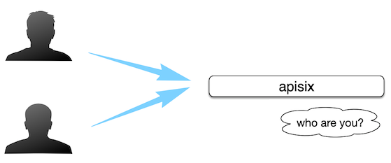

<!--
#
# Licensed to the Apache Software Foundation (ASF) under one or more
# contributor license agreements.  See the NOTICE file distributed with
# this work for additional information regarding copyright ownership.
# The ASF licenses this file to You under the Apache License, Version 2.0
# (the "License"); you may not use this file except in compliance with
# the License.  You may obtain a copy of the License at
#
#     http://www.apache.org/licenses/LICENSE-2.0
#
# Unless required by applicable law or agreed to in writing, software
# distributed under the License is distributed on an "AS IS" BASIS,
# WITHOUT WARRANTIES OR CONDITIONS OF ANY KIND, either express or implied.
# See the License for the specific language governing permissions and
# limitations under the License.
#
-->

## 描述

在 APISIX 中，Consumer 表示通过网关发送请求并使用后端服务的用户、应用或主机。Consumer 通常与认证插件配合使用。认证插件根据请求凭证识别 Consumer，并在 APISIX 处理请求时使其插件配置生效。

Route 可以根据请求域名、客户端 IP 地址等属性匹配请求，但这些属性不一定能识别发起请求的应用或用户。



Consumer 可以配置插件，也可以引用 Consumer Group 以共享插件配置。当多个局部对象配置了同一插件时，APISIX 会按照[插件合并优先顺序](./plugin.md#插件合并优先顺序)合并这些配置。

## 配置选项

定义 Consumer 的字段如下：

| 名称 | 必选项 | 描述 |
| ---- | ------ | ---- |
| `username` | 是 | Consumer 的唯一名称。 |
| `desc` | 否 | Consumer 的描述。 |
| `labels` | 否 | Consumer 的标签。 |
| `group_id` | 否 | Consumer Group 的 ID，其插件配置会与 Consumer 的插件配置合并。 |
| `plugins` | 否 | Consumer 的插件配置。详细信息请参见 [Plugins](./plugin.md)。 |

## 识别消费者

在 APISIX 中，识别 Consumer 的过程如下：

1. 认证插件（例如 [key-auth](../plugins/key-auth.md) 或 [jwt-auth](../plugins/jwt-auth.md)）验证请求凭证。
2. 认证插件通过唯一的 `username` 识别 Consumer。
3. APISIX 将 Consumer 和 Consumer Group 的插件配置与匹配到的 Route、Plugin Config 和 Service 的插件配置合并。

当不同应用或用户请求同一 API，并且需要不同的限流或访问控制等插件配置时，可以使用 Consumer。Consumer 本身不包含 Upstream 配置。

在 APISIX 中启用的认证插件可以配置在 Consumer 上，例如 `basic-auth`、`hmac-auth`、`jwt-auth`、`key-auth`、`ldap-auth` 和 `wolf-rbac`。

你可以参考 [key-auth](../plugins/key-auth.md) 认证授权插件的调用逻辑，进一步理解 Consumer 概念和使用。

:::note 注意

如需了解更多关于 Consumer 对象的信息，你可以参考 [Admin API Consumer](../admin-api.md#consumer) 资源介绍。

:::

## 使用示例

以下示例介绍了如何对某个 Consumer 开启指定插件：

:::note

您可以这样从 `config.yaml` 中获取 `admin_key` 并存入环境变量：

```bash
admin_key=$(yq '.deployment.admin.admin_key[0].key' conf/config.yaml | sed 's/"//g')
```

:::

1. 创建 Consumer，指定认证插件 `key-auth`，并开启特定插件 `limit-count`。

    ```shell
    curl http://127.0.0.1:9180/apisix/admin/consumers \
    -H "X-API-KEY: $admin_key" -X PUT -d '
    {
        "username": "jack",
        "plugins": {
            "key-auth": {
                "key": "auth-one"
            },
            "limit-count": {
                "count": 2,
                "time_window": 60,
                "rejected_code": 503,
                "key": "remote_addr"
            }
        }
    }'
    ```

2. 创建路由，设置路由规则和启用插件配置。

    ```shell
    curl http://127.0.0.1:9180/apisix/admin/routes/1 \
    -H "X-API-KEY: $admin_key" -X PUT -d '
    {
        "plugins": {
            "key-auth": {}
        },
        "upstream": {
            "nodes": {
                "127.0.0.1:1980": 1
            },
            "type": "roundrobin"
        },
        "uri": "/hello"
    }'
    ```

3. 测试插件。

    连续发送三次测试请求，前两次返回正常，没达到限速阈值。

    ```shell
    curl http://127.0.0.1:9080/hello -H 'apikey: auth-one' -I
    ```

    第三次测试返回 `503`，请求被限制：

    ```shell
    HTTP/1.1 503 Service Temporarily Unavailable
    ...
    ```

通过 [consumer-restriction](../plugins/consumer-restriction.md) 插件，限制用户 `jack` 对该 Route 的访问。

1. 设置黑名单，禁止 jack 访问该 API。

    ```shell
    curl http://127.0.0.1:9180/apisix/admin/routes/1  \
    -H "X-API-KEY: $admin_key" -X PUT -d '
    {
        "plugins": {
            "key-auth": {},
            "consumer-restriction": {
                "blacklist": [
                    "jack"
                ]
            }
        },
        "upstream": {
            "nodes": {
                "127.0.0.1:1980": 1
            },
            "type": "roundrobin"
        },
        "uri": "/hello"
    }'
    ```

2. 通过以下命令访问该路由，均返回 `403`，`jack` 被禁止访问。

    ```shell
    curl http://127.0.0.1:9080/hello -H 'apikey: auth-one' -I
    ```

    返回结果：

    ```
    HTTP/1.1 403
    ...
    ```
